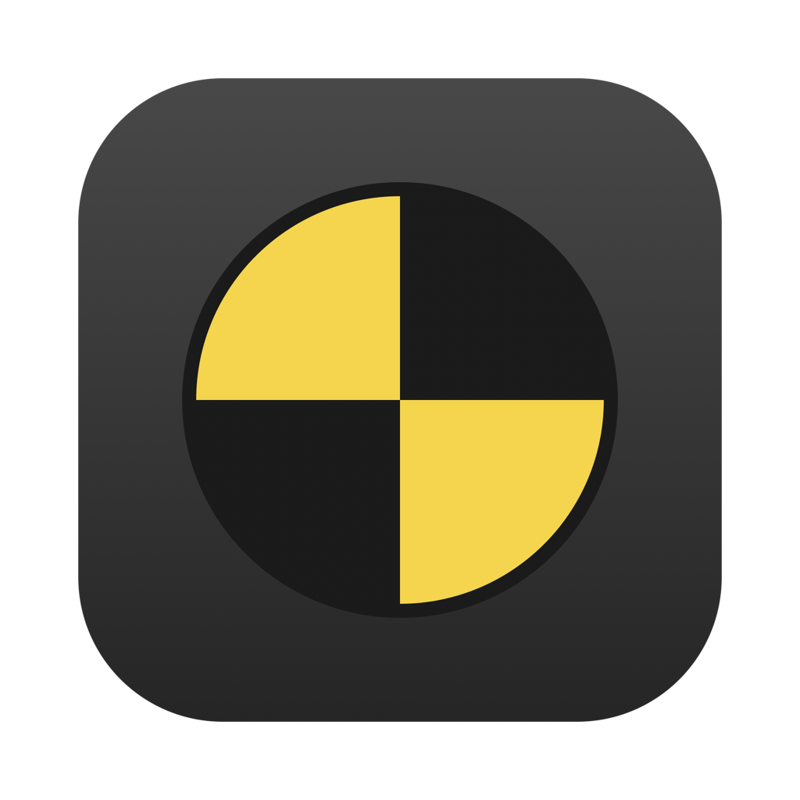

<div align="center">

# BeamMac

A launcher that runs BeamNG.drive on Apple Silicon Macs. It installs Wine, the Metal graphics layers and the Windows Steam client on its own, so the only thing left for you is logging in to Steam.




[Download](https://github.com/jx-grxf/BeamMac/releases/latest) · [How it works](#how-it-works) · [Terminal](#terminal)

</div>

> [!TIP]
> Built for the moment you want to drive and not spend an evening on Wine prefixes, DLL overrides and Steam settings.

## What it does

**Setup**

- A first-run window checks the Mac (Apple Silicon, Rosetta, free space), lists what it will download with sizes and licenses, and installs it with one click: Wine 10 from Sikarugir, DXMT, Apple's D3DMetal and Steam for Windows, about 265 MB.
- After the Steam login it opens Steam's install dialog for BeamNG.drive and shows the download until the game is ready.
- Everything lives in `~/Library/Application Support/BeamMac`, or on another disk if you pick one. Nothing goes to `/Applications` or `~/.wine`.

**Starting the game**

- Steam starts hidden in the background when BeamMac opens, so the game starts in about 25 seconds instead of a minute and a half.
- Steam's own update check at startup hangs for a 60-second timeout under Wine; BeamMac skips it and lets Steam update once a week.
- Steam keeps running between drives and is only restarted when a setting needs a different environment.
- Game updates show as a progress bar with the downloaded size; the drive button waits until Steam is done.
- The game always starts with Direct3D 11, which the Metal layers translate, instead of probing Direct3D 12 first.

**Graphics**

- DXMT translates Direct3D 11 to Metal, upscales with MetalFX and paces frames through Metal. Apple's D3DMetal from the Game Porting Toolkit is one switch away.
- Profiles (Smooth, Balanced, Pretty) set BeamNG's quality level, effects, traffic and the frame limit together; every value can also be changed on its own.
- The resolution follows the display the game opens on, and the MetalFX factor follows its backing scale.
- Steam's overlay is kept out of the game, since it hooks every frame.

**Controllers**

- PlayStation and Xbox controllers reach BeamNG as XInput gamepads. Wine's default hands a DualShock over as a raw HID device, which BeamNG never reads under Wine.
- Steam Input is turned off for BeamNG, so Steam does not take the controller for itself.
- A controller page shows battery, sets the light bar color and has a live test for sticks, triggers and buttons.

**Mods**

- Lists the ZIPs in BeamNG's mod folder, adds new ones by drag and drop and moves removed ones to the Trash.

## Install

1. Download `BeamMac.dmg` from [Releases](https://github.com/jx-grxf/BeamMac/releases/latest) and drag BeamMac into Applications.
2. Open it and click **Install**.
3. Log in to Steam when it opens, then click **Install** next to BeamNG.drive.

You need to own BeamNG.drive on Steam.

## Requirements

- Mac with Apple Silicon
- macOS 14 or newer
- Rosetta 2 (BeamMac offers to install it)
- About 70 GB free: 55 GB for the game, the rest for Wine, Steam and updates

## How it works

BeamNG.drive and Steam run as Windows programs in a Wine prefix. The scripts in `bin/` and `lib/` do the work; the app runs them and reads their output, so the terminal and the app always behave the same.

| Part | Source | License |
|---|---|---|
| Wine 10 engine | [Sikarugir](https://github.com/Sikarugir-App) | LGPL 2.1 |
| DXMT (Direct3D 11 → Metal) | [3Shain/dxmt](https://github.com/3Shain/dxmt) | LGPL 2.1 |
| D3DMetal | Apple, Game Porting Toolkit | Apple license, downloaded on your Mac, never redistributed here |
| Steam for Windows | Valve | Steam Subscriber Agreement |

Each engine variant is an APFS clone, so DXMT, D3DMetal and plain WineD3D share one prefix and one Steam library at almost no extra space.

## Terminal

```sh
bin/setup                          # engine, DXMT, D3DMetal, prefix, Steam
bin/beamng                         # start BeamNG with DXMT and MetalFX
bin/beamng --hud                   # with Apple's Metal HUD
bin/beamng --d3dmetal              # Apple D3DMetal instead of DXMT
bin/beamng --upscaler off          # no MetalFX
bin/beamng --steam-only            # open Steam
bin/stop                           # end Steam, BeamNG and the wineserver
bin/wine winecfg                   # any Wine command inside the prefix
```

`BEAMMAC_HOME` sets where engines, downloads and the prefix go. A checkout that already holds a prefix in `data/` keeps using it.

## Development

```sh
script/build_and_run.sh            # build dist/BeamMac.app and open it
script/build_and_run.sh install    # copy it to ~/Applications
```

SwiftUI, Swift Package Manager, no Xcode project. The app bundles `bin/`, `lib/` and `config/` in its resources.

## License

MIT for BeamMac's own code, see [LICENSE](LICENSE). The components above keep their own licenses.

BeamMac is not affiliated with BeamNG GmbH, Valve or Apple. BeamNG.drive is a trademark of BeamNG GmbH.
